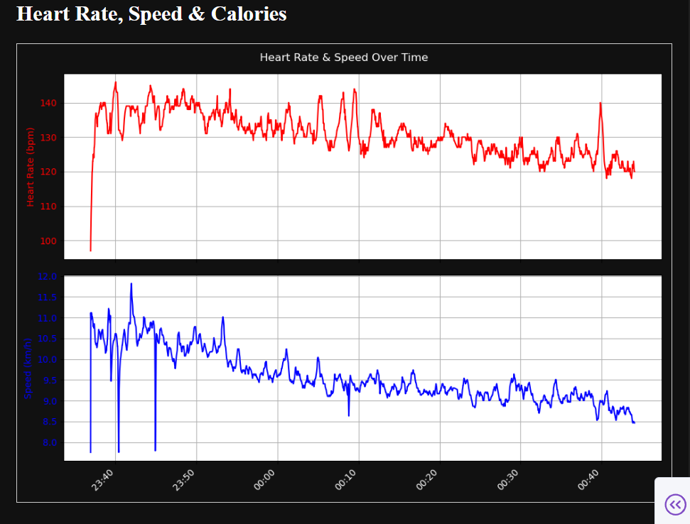
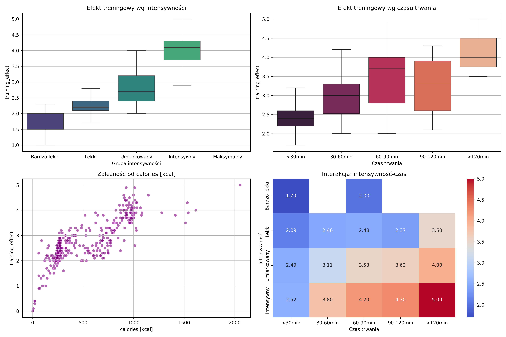

# Analiza rzeczywistych danych treningowych

Projekt z przedmiotu Przetwarzanie danych ustrukturyzowanych.

Analizowane dane pochodzą z zegarka sportowego naszego profesora i obejmują około 1700 treningów: jazdę na rowerze, bieganie po asfalcie i w terenie, spacery oraz wędrówki. Każdy trening był zapisany w dwóch postaciach: jako podsumowanie w pliku JSON (czas, dystans, kalorie, tętno, efekt treningowy) i jako szczegółowy przebieg w pliku CSV z pomiarami rejestrowanymi w trakcie aktywności (pozycja GPS, tętno, prędkość, wysokość, kadencja). Pracę podzieliliśmy na trzy problemy, z których każdy opracowała jedna osoba.

Dane nie są dołączone do repozytorium.

## Struktura repozytorium

| Folder | Zawartość |
|---|---|
| `pobranie_danych/` | Połączenie wszystkich plików JSON w jedną tabelę, z której korzystają analiza efektu treningowego i modele kalorii |
| `mapa_treningow/` | Scalenie danych JSON i CSV oraz interaktywny dashboard z trasą treningu |
| `efekt_treningowy/` | Podział treningów na dyscypliny i analiza czynników wpływających na efekt treningowy, wykresy w `wykresy/` |
| `kalorie_ml/` | Przygotowanie danych i modele przewidujące liczbę spalonych kalorii |
| `prezentacja/` | Prezentacja podsumowująca projekt |

## Mapa treningów – Szymon

**Jak wyglądały treningi profesora?**

Pomiary z plików CSV zostały zagregowane do poziomu pojedynczych treningów i połączone z podsumowaniami z plików JSON. Na tej podstawie powstał dashboard w Dash. Po wybraniu treningu z listy wyświetla się jego trasa na mapie, podsumowanie (dystans, czas, kalorie, średnie tętno, prędkość, temperatura) oraz przebieg tętna i prędkości w czasie. Na trasie oznaczone są odcinki zmęczenia, czyli fragmenty, w których przez co najmniej cztery kolejne pomiary tętno rośnie, a prędkość spada.

## Efekt treningowy – Jakub

**Jak trenować, żeby uzyskać jak największy efekt treningowy?**

Efekt treningowy (`training_effect`) to wyliczany przez zegarek wskaźnik w skali 0–5, opisujący wpływ treningu na wydolność. Treningi zostały podzielone na pięć dyscyplin. Dla każdej z nich policzona została korelacja Spearmana efektu treningowego z dystansem, czasem, przewyższeniem, tętnem, kaloriami i temperaturą. Następnie porównano efekt w grupach intensywności (według średniego tętna) i czasu trwania treningu.

Poniżej wynik dla biegania w terenie. Efekt rośnie zarówno z intensywnością, jak i z czasem trwania, a najwyższe wartości osiągają długie, intensywne treningi.

## Kalorie – Krzysztof

**Od czego zależy liczba spalonych kalorii?**

Z tabeli zebranej z plików JSON usunięte zostały kolumny zdublowane lub z dużą liczbą braków, np. prędkość, którą można wyliczyć z dystansu i czasu, oraz parametry biegowe dostępne tylko dla około 10% treningów. Odpowiadające sobie kolumny różnych dyscyplin, takie jak kadencja oraz liczba kroków i obrotów korby, zostały połączone w jedną. Braki uzupełniono medianą w obrębie dyscypliny i odrzucono obserwacje odstające. Na tak przygotowanych danych porównana została regresja liniowa z lasem losowym:

| | Regresja liniowa | Las losowy |
|---|---|---|
| MAE [kcal] | 30.97 | 19.15 |
| RMSE [kcal] | 41.12 | 31.82 |
| R² | 0.983 | 0.990 |
| MAPE | 8.97% | 4.76% |

Las losowy myli się średnio o niecałe 5%. Zdecydowanie najważniejszą cechą okazała się w nim liczba okrążeń, a w dalszej kolejności liczba kroków lub obrotów korby i dystans.

## Autorzy

- Szymon Domański – [@domanskis06](https://github.com/domanskis06)
- Jakub Gronkiewicz – [@GronkiewiczJ](https://github.com/GronkiewiczJ)
- Krzysztof Dąbrowski – [@dabrowskik05](https://github.com/dabrowskik05)
